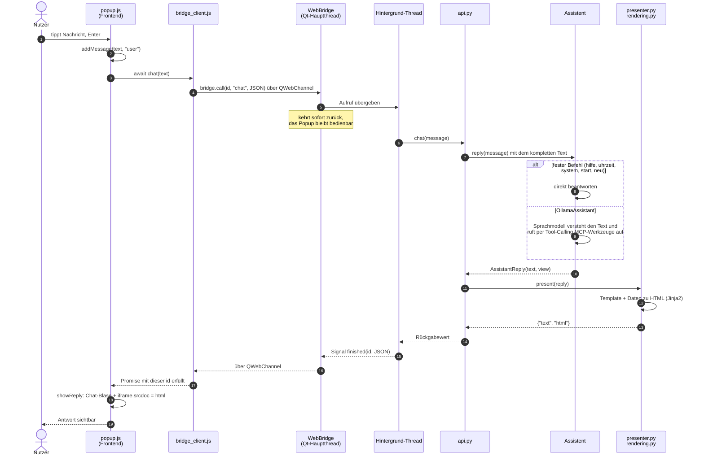

# Architektur – Personal Digital Agent (PDA)

Ausführliche Beschreibung, wie das Projekt aufgebaut ist und warum. Für den Einstieg (Starten, Testen, wo arbeite ich?) reicht die [README](README.md).

Tray-Anwendung für Windows: Das Programm läuft im Hintergrund und zeigt ein Icon im
Infobereich der Taskleiste.

- **Linksklick** auf das Icon öffnet ein Popup: oben ein Anzeigebereich (iframe) für Daten,
  unten ein Chat mit einem Assistenten.
- **Rechtsklick** öffnet das Kontextmenü mit „Beenden“.

Das Popup ist eine Webseite (HTML/CSS/JavaScript), die in einem eingebetteten Chromium
(Qt WebEngine) läuft. Die Logik ist in Python geschrieben. Eine Brücke verbindet beide Seiten:
JavaScript ruft Python-Funktionen auf, als wären es JavaScript-Funktionen, und das Backend kann
von sich aus Nachrichten an das Frontend schicken.

## Inhalt

1. [Projektziel und Erweiterungspunkte](#projektziel-und-erweiterungspunkte)
2. [Ordnerstruktur](#ordnerstruktur)
3. [Frontend und Backend](#frontend-und-backend)
4. [Programmstart](#programmstart)
5. [Linksklick und Rechtsklick](#linksklick-und-rechtsklick)
6. [Brücke JavaScript ↔ Python](#brücke-javascript--python)
7. [Weg einer Chat-Nachricht](#weg-einer-chat-nachricht)
8. [Frontend](#frontend)
9. [Assistent und Schnittstellen](#assistent-und-schnittstellen)
10. [Konfiguration](#konfiguration)
11. [Tests und Coverage](#tests-und-coverage)
12. [Bekannte Fallstricke](#bekannte-fallstricke)
13. [Kurzanleitung: Erweitern](#kurzanleitung-erweitern)

---

## Projektziel und Erweiterungspunkte

Ziel ist **ein** durchgehender persönlicher KI-Assistent mit lokalem Sprachmodell (Ollama). Er
deckt drei Aufgabenbereiche ab, im Code **Fähigkeiten** (Skills) genannt:

| Fähigkeit | Wofür | Integrationen |
|---|---|---|
| `morning` | kurzes Briefing über den Tag | Google Calendar, OpenWeather, Aktien-API, Musik |
| `travel` | wie komme ich zum nächsten Termin? | Google Calendar, openrouteservice, DB Timetables, Tankerkönig |
| `organization` („Assistant²“) | Nachrichten verfassen, Tag organisieren | Google Calendar, Gmail, Google Keep |

**Warum ein Assistent statt drei?** Präferenzen, Gesprächsverlauf und Rückfragen gehören zu einer
Person. Google Calendar brauchen alle drei Bereiche, und Anfragen mischen sie oft („Wann muss ich
los, und schreib Max, dass ich später komme“). Das Sprachmodell wählt per Tool-Calling selbst
die passenden Werkzeuge, ein Umschalter oder Router zwischen Assistenten ist nicht nötig.

Der KI-Assistent mit Ollama und MCP-Werkzeugen läuft; die Fähigkeiten selbst und eigene
Integrationen sind **noch nicht umgesetzt**. Jede Anforderung hat einen festen Platz:

| Anforderung | Wo im Code | Stand |
|---|---|---|
| Fähigkeiten (morning, travel, organization) | `backend/assistant/skills/` – je ein `Skill` mit Integrationen, Anweisungen und optionalem Auslöser | travel fertig (`skills/travel/`), morning und organization offen |
| Integrationen (Calendar, Wetter, Gmail …) | `backend/integrations/` – Clients für externe Dienste, als Werkzeuge über die Fähigkeiten | Google Calendar, openrouteservice, DB Timetables, Tankerkönig |
| MCP-Server als Werkzeuge | `MCPToolProvider` in `backend/integrations/mcp_client.py`, Liste in `mcp_servers.json` | fertig (stdio), eigener Server `mcp_servers/pda_server.py` |
| Lokales Sprachmodell (Ollama) | `OllamaModel` in `backend/assistant/ollama.py`, `OllamaAssistant` in `ollama_assistant.py` | fertig, Modellwahl im Popup |
| Autonom (z. B. Briefing ohne Eingabe) | `backend/events.py`, `presenter.push(reply)` → Nachricht im Chat | Push-Kanal fertig |
| Kontextwissen, Präferenzen per UI | `PreferenceStore` / `JsonPreferenceStore` in `backend/preferences.py` | Speicherung fertig, UI offen |
| Sprachliche Ein- und Ausgabe | `SpeechInput` / `SpeechOutput` in `backend/speech.py` | Schnittstelle |
| Kurze Antworten, Rückfragen | `Assistant.reply()`; der Assistent hält den Gesprächsverlauf | über das Protokoll möglich |
| Langsame Aufrufe (Modell, APIs) | Bridge führt Aufrufe im Hintergrund-Thread aus | fertig |
| PyTest | `pytest.ini`, `requirements-dev.txt` | eingerichtet |

Die Konventionen für Fähigkeiten und Integrationen stehen jeweils in der `__init__.py` des Ordners.

---

## Ordnerstruktur

```
main.py                       Einstiegspunkt – startet das Programm
mcp_servers.json              MCP-Server, deren Werkzeuge der Assistent nutzt
.env.example                  Vorlage für .env: API-Keys und Zugangsdaten (.env wird nicht eingecheckt)
mcp_servers/                  eigene MCP-Server (eigene Prozesse, nicht Teil von backend/)
  pda_server.py               Server mit offiziellem SDK: Uhrzeit, Rechnen, E-Mail senden und lesen
  basic_tools.py              Uhrzeit und Rechnen (ohne Abhängigkeiten)
  mailer.py                   E-Mail per SMTP, nur an freigegebene Empfänger
  inbox.py                    E-Mail und Anhänge lesen per IMAP, nur lesend
  file_text.py                Text aus PDF, Word, Excel, PowerPoint, HTML, Textdateien
  demo_server.py              Server ohne SDK: zeigt das Protokoll, Gegenpart in den Tests

frontend/                     FRONTEND: läuft im Browser (HTML/CSS/JS)
  popup.html/.css/.js         Popup: Anzeige oben, Chat unten
  theme.css                   gemeinsame Farben
  templates/
    default.html.j2           Standard-Template (Titel, Text, Tabelle) – weitere *.html.j2 möglich
    view.css                  gemeinsames Layout der Ansichten

backend/                      BACKEND: läuft in Python
  api.py                      ← Schnittstelle zum Frontend (nur diese Funktionen sieht das JS)
  events.py                   ← Ereignisse vom Backend ans Frontend (Push)
  presenter.py                Antwort des Assistenten → {"text", "html", "attachments"}; push() für autonome Nachrichten
  attachments.py              Dateien im Chat (z. B. Mail-Anhänge): öffnen, speichern
  config.py                   alle Einstellungen
  views.py                    Ansicht-Anfragen: TemplateView oder HtmlView
  rendering.py                macht aus einer Anfrage HTML (Jinja2 bzw. eigenes HTML)
  preferences.py              Kontextwissen, persönliche Präferenzen (JsonPreferenceStore)
  speech.py                   Schnittstelle: Spracheingabe und -ausgabe
  assistant/                  Fachlogik: Assistent hinter dem Chat
    base.py                   Assistant-Protokoll, AssistantReply, ModelSelection
    commands.py               CommandAssistant (feste Befehle, auch im KI-Assistenten gültig)
    llm.py                    LanguageModel-Protokoll
    ollama.py                 OllamaModel: LanguageModel über die HTTP-API von Ollama
    ollama_assistant.py       OllamaAssistant: Verlauf + Tool-Calling-Schleife
    tools.py                  ToolProvider-Protokoll + CompositeToolProvider
    skills/                   Fähigkeiten des Assistenten (SKILLS, start_triggers)
      base.py                 Skill-Typ
      travel/                 Reise-Assistent: planner, service, view, tools, reminder
  integrations/               externe Dienste
    mcp_client.py             MCPToolProvider: Werkzeuge eines MCP-Servers (stdio)
    http.py                   JsonHttp: gemeinsamer HTTP-Client (urllib), IntegrationError
    google_calendar.py        Termine lesen (OAuth, Desktop-App)
    geo.py                    Place, Luftlinie
    openrouteservice.py       Adressen + Routen (Auto, Fahrrad, zu Fuß)
    db_timetables.py          DB-Fahrplan: Bahnhöfe, Direktverbindungen
    tankerkoenig.py           Spritpreise
  bridge/                     Verbindung Frontend ↔ Backend (muss nicht angepasst werden)
    function_registry.py      findet die Funktionen aus api.py
    web_bridge.py             Python-Seite der Brücke (QWebChannel)
    bridge_client.js          JS-Seite der Brücke, wird automatisch in jede Seite eingefügt
  desktop/                    Qt-Hülle, in der das Frontend angezeigt wird
    application.py            setzt die Bausteine zusammen
    tray_icon.py              Tray-Icon + Kontextmenü
    popup_window.py           Popup-Fenster + Einfahr-Animation
    web_view.py               Browser-Ansicht mit angehängter Brücke

tests/                        automatische Tests (pytest), gegliedert wie backend/
  assistant/  bridge/  desktop/
pytest.ini                    Testkonfiguration (Coverage bei jedem Lauf)
```

Jede Datei hat genau eine Aufgabe (Single-Responsibility-Prinzip).

---

## Frontend und Backend

```
┌──────────────────────────────┐            ┌──────────────────────────────────┐
│ FRONTEND  (frontend/)        │            │ BACKEND  (backend/)              │
│ läuft im Browser             │            │ läuft in Python                  │
│                              │  await     │                                  │
│ popup.js ── chat("system") ──┼──bridge/──►│ api.py ── chat() ──► assistant/  │
│                              │            │     TemplateView/HtmlView   ◄┘   │
│                              │            │              │                   │
│ templates/*.html.j2 ─────────┼────────────┼──► rendering.py (Jinja2)         │
│                              │            │              │                   │
│ iframe.srcdoc ◄── HTML ──────┼◄── JSON ───┤ {"text": ..., "html": ...}       │
└──────────────────────────────┘            └──────────────────────────────────┘
               ▲  angezeigt in
     backend/desktop/  (Tray-Icon, Popup-Fenster, WebView)
```

Die beiden Seiten kennen sich nur über **drei Verträge**:

1. **Funktionen:** Jede öffentliche Funktion in [backend/api.py](backend/api.py) ist im
   Frontend unter demselben Namen aufrufbar (`await name(...)`). Heute gibt es:

   | Funktion | Argument | Rückgabe |
   |---|---|---|
   | `chat(message)` | Text des Nutzers | `{"text": str, "html": str \| null}` – `html` ist die fertig gerenderte Ansicht, `null` = Ansicht beibehalten |
   | `render_view(request)` | Ansicht-Anfrage (siehe unten) | fertiges HTML fürs iframe |
   | `start_view()` | – | HTML der Startansicht |
   | `list_models()` | – | `{"models": [{"name", "tools"}], "current": str \| null}` – leer ohne Sprachmodell |
   | `select_model(name)` | Modellname | Name; Wahl bleibt gespeichert |

2. **Ansicht-Anfragen:** Eine Ansicht wird immer auf eine von zwei Arten angefordert – vom
   Assistenten im Backend ebenso wie vom Frontend über `render_view(request)`:

   ```js
   // Template aus frontend/templates/<template>.html.j2 mit Daten füllen
   await render_view({template: "default", data: {title: "Hallo", text: "Welt"}});

   // eigenes HTML unverändert anzeigen
   await render_view({html: "<h1>Eigenes HTML</h1>"});
   ```

   In Python sind das `TemplateView(template, data)` und `HtmlView(html)` aus
   [backend/views.py](backend/views.py). Welche Daten ein Template erwartet, steht als Kommentar
   oben im Template (siehe [Frontend](#frontend)).

3. **Ereignisse (Push):** Das Backend kann ohne Anfrage Nachrichten schicken. Im Frontend kommen
   sie bei `onPythonEvent(name, handler)` an:

   | Ereignis | Payload | Wirkung im Popup |
   |---|---|---|
   | `assistant_message` | `{"text": str, "html": str \| null}` (wie bei `chat`) | Nachricht im Chat, ggf. neue Ansicht |

   Im Backend: `events.publish(name, payload)` aus [backend/events.py](backend/events.py), für
   Assistenten-Nachrichten einfach `presenter.push(reply)`.

Daraus folgt:

- **Wer am Frontend arbeitet**, ändert nur Dateien in `frontend/` und braucht vom Backend nur
  diese drei Verträge.
- **Wer am Backend arbeitet**, ändert vor allem `backend/api.py` und `backend/assistant/`.
  Solange die Verträge gleich bleiben, merkt das Frontend davon nichts.
- **`backend/bridge/` und `backend/desktop/`** sind Infrastruktur und müssen für neue Funktionen
  oder Ansichten nicht angefasst werden.

---

## Programmstart

```
main.py: main()
 ├─ logging einrichten
 ├─ configure_qt()          High-DPI aktivieren, eigenes Taskleisten-Icon (Windows)
 ├─ QApplication(sys.argv)  die Qt-Anwendung (genau eine pro Prozess)
 ├─ Application(qt_app)     ← backend/desktop/application.py
 │   ├─ create_popup()
 │   │   ├─ FunctionRegistry.from_module(api)   sammelt die Funktionen aus api.py
 │   │   ├─ WebView(...)                        Browser-Ansicht
 │   │   │   ├─ web_bridge.attach(...)          Brücke einrichten
 │   │   │   └─ load(frontend/popup.html)
 │   │   └─ PopupWindow(view)                   Fenster um die Ansicht
 │   ├─ TrayIcon(...)                           Icon + Kontextmenü
 │   └─ Signale verbinden:
 │        tray.left_clicked   → popup.show_at_cursor
 │        tray.quit_requested → qt_app.quit
 └─ qt_app.exec_()          Event-Schleife läuft bis „Beenden“
```

**[main.py](main.py)** enthält nur den Start. `configure_qt()` ist eine eigene Funktion, weil
diese Einstellungen gesetzt sein müssen, bevor die `QApplication` entsteht. Die Zeile
`application = Application(qt_app)` hält eine Referenz auf das Objekt. Ohne sie würde Python es
wegräumen.

**[backend/desktop/application.py](backend/desktop/application.py)** ist der *Composition Root*: die einzige Stelle, an
der die Bausteine erzeugt und verbunden werden. Die Bausteine kennen sich gegenseitig nicht. Das
Tray-Icon weiß nichts vom Popup und meldet nur per Signal „ich wurde angeklickt“ (lose Kopplung).
Dadurch lässt sich jeder Teil einzeln testen und austauschen.

`Application` erbt bewusst **nicht** von `QApplication`, sondern bekommt sie übergeben. Qt
erlaubt nur eine `QApplication` pro Prozess. Bei Vererbung ließe sich die Klasse in Tests nicht
erzeugen, weil die Tests schon eine eigene `QApplication` haben.

---

## Linksklick und Rechtsklick

**[backend/desktop/tray_icon.py](backend/desktop/tray_icon.py)**

- Im Konstruktor wird ein `QMenu` mit „Beenden“ als `contextMenu` gesetzt. Bei einem
  Rechtsklick zeigt Windows dieses Menü automatisch an.
- Bei einem Klick ruft Qt `_on_activated(reason)` auf. Nur bei `reason == Trigger` (Linksklick)
  wird das Signal `left_clicked` gesendet.
- „Beenden“ sendet `quit_requested`. Was daraufhin passiert, entscheidet `application.py`.

**[backend/desktop/popup_window.py](backend/desktop/popup_window.py)**

- `Qt.Popup | Qt.FramelessWindowHint` ergibt ein Fenster ohne Rahmen, das sich bei einem Klick
  daneben automatisch schließt.
- `show_at_cursor()` berechnet die Größe als Anteil des Bildschirms (`POPUP_SIZE_RATIO`). Die
  Endposition liegt so, dass die **untere rechte Ecke am Mauszeiger** sitzt, also dort, wo das
  Tray-Icon ist. Eine `QPropertyAnimation` lässt das Fenster von rechts unten hineingleiten.
- `closeEvent` versteckt das Fenster nur, statt es zu zerstören. Der Chat-Verlauf bleibt dadurch
  erhalten, wenn man das Popup wieder öffnet.

---

## Brücke JavaScript ↔ Python

JavaScript im Browser kann Python nicht direkt aufrufen. Qt bietet dafür **QWebChannel**: Man
registriert ein Python-Objekt (`QObject`), und JavaScript bekommt ein Stellvertreter-Objekt,
dessen Methoden Nachrichten an Python schicken und dessen Signale JavaScript empfangen kann. Die
Brücke besteht aus vier Teilen.

### a) `function_registry.py` – Funktionen finden

```python
FunctionRegistry.from_module(api)
```

Die Registry geht alle Einträge des Moduls durch und behält nur die, die

- eine Funktion sind (`inspect.isfunction`),
- **in diesem Modul definiert** wurden (`obj.__module__ == module.__name__`), also keine
  importierten Funktionen,
- **nicht mit `_` beginnen**, also nicht privat sind.

`call(name, args)` ruft die passende Funktion auf oder wirft `UnknownFunctionError`. Die Datei
braucht **kein Qt** und ist deshalb einfach zu testen.

### b) `web_bridge.py` – Python-Seite

- `WebBridge` ist ein `QObject` mit einem Slot und zwei Signalen:
  - **Slot `call(call_id, name, args_json)`:** JavaScript schickt eine Aufruf-Nummer,
    Funktionsname und Argumente. Der Slot gibt die Arbeit nur an einen **Hintergrund-Thread**
    weiter und kehrt sofort zurück. So friert das Popup auch bei langsamen Funktionen
    (Sprachmodell, Web-APIs) nicht ein.
  - **Signal `finished(call_id, json)`:** Wenn die Funktion fertig ist, kommt das Ergebnis als
    JSON-Umschlag zurück:
    - Erfolg: `{"ok": true, "result": ...}`
    - Fehler: `{"ok": false, "error": "Meldung"}`

    Fehler werden abgefangen und protokolliert. Eine fehlerhafte Funktion lässt also nicht das
    Programm abstürzen.
  - **Signal `event(name, json)`:** leitet Ereignisse aus `backend/events.py` ans Frontend weiter.
- Es gibt **genau einen** Hintergrund-Thread. Aufrufe laufen nacheinander ab, deshalb muss der
  Assistent nicht thread-sicher sein. Ein langer Aufruf hält aber die nachfolgenden auf.
- `attach(page, registry, event_bus)` macht vier Dinge:
  1. `WebBridge` mit Hintergrund-Thread erzeugen und auf einem `QWebChannel` unter dem Namen
     `"bridge"` registrieren.
  2. Den Kanal an die Seite hängen.
  3. Die Bridge beim `EventBus` anmelden.
  4. Ein Skript in jede Seite einfügen (`QWebEngineScript`, Zeitpunkt `DocumentCreation`, also
     bevor die Seite ihr eigenes JavaScript ausführt). Es besteht aus:
     - `qwebchannel.js` (Bibliothek von Qt, aus Qts eingebauten Ressourcen),
     - `const __PYTHON_FUNCTIONS__ = ["chat", ...];` (Liste der Funktionsnamen),
     - `bridge_client.js`.
- `attach` gibt eine `BridgeConnection` zurück, die der Aufrufer **behalten muss**. Ohne
  Referenz räumt Python die Bridge weg, und JavaScript sieht ihre Methode nicht mehr.
  `close()` meldet die Bridge ab und beendet den Thread. Danach beantwortet sie Aufrufe nur
  noch mit einem Fehler.

### c) `bridge_client.js` – JavaScript-Seite

```js
for (const name of __PYTHON_FUNCTIONS__) {
  window[name] = (...args) => callPython(name, args);
}
```

Für jede Python-Funktion entsteht eine gleichnamige globale JavaScript-Funktion. Deshalb kann
`popup.js` einfach `await chat(text)` schreiben.

`callPython` vergibt eine fortlaufende Aufruf-Nummer, merkt sich das zugehörige Promise und
schickt `bridge.call(callId, name, JSON)`. Kommt `finished(callId, …)` zurück, wird das passende
Promise erfüllt (`ok: true`) oder mit einem Fehler abgelehnt. Die Verbindung zum Kanal entsteht
erst bei Bedarf, denn erst dann ist `qt.webChannelTransport` sicher verfügbar.

`onPythonEvent(name, handler)` meldet einen Handler für Ereignisse aus dem Backend an und baut
dabei die Verbindung auf, damit Ereignisse auch ohne vorherigen Aufruf ankommen.

**Warum `await`?** Die Antwort von Python kommt asynchron über den Kanal zurück. Jeder Aufruf
braucht daher `await`, und die aufrufende Funktion muss `async` sein.

### d) `web_view.py` – alles zusammen

`WebView` ist ein `QWebEngineView`. Im Konstruktor setzt die Klasse die Hintergrundfarbe (damit
beim Laden nichts weiß aufblitzt), hängt die Brücke an, behält die Referenz darauf und lädt die
HTML-Datei. `close_bridge()` wird beim Beenden der App aufgerufen.

---

## Weg einer Chat-Nachricht



Die Schritte 1–7 (hin) und 14–19 (zurück) sind reiner Transport: Der Text kommt **unverändert**
im Assistenten an, und die Antwort geht unverändert zurück. Was mit dem Text passiert, entscheidet
allein der Assistent (Schritt 8 bzw. 9). Feste Befehle werden exakt verglichen. Alles andere
bekommt der `OllamaAssistant`: Das Modell versteht den Text und wählt selbst die passenden
Werkzeuge. Eine Antwort des Modells dauert je nach Modell und Rechner einige Sekunden; solange
zeigt der Chat „denkt nach …“.

Dasselbe mit den Code-Stellen, Beispiel: Eingabe **„system“** und Enter.

```
popup.js  sendMessage()
  │  zeigt "system" als Nutzer-Blase an
  │  const reply = await chat("system")
  ▼
bridge_client.js  window.chat → callPython("chat", ["system"])
  │  bridge.call(1, "chat", '["system"]')     über QWebChannel, Aufruf-Nr. 1
  ▼
web_bridge.py  WebBridge.call  → übergibt an den Hintergrund-Thread, kehrt sofort zurück
  │  (Hintergrund-Thread) registry.call("chat", ["system"])
  ▼
api.py  chat("system")
  │  reply = _assistant().reply("system")
  ▼
assistant/commands.py  CommandAssistant.reply
  │  "system" ist in COMMANDS → _system()
  │  → AssistantReply("Hier sind die Systeminfos.",
  │       TemplateView("default", {"title": "System", "columns": [...], "rows": [...]}))
  ▼
presenter.py  present(reply)
  │  renderer().render(reply.view)
  ▼
rendering.py  ViewRenderer.render
  │  frontend/templates/default.html.j2 mit den Daten füllen (Jinja2)
  ▲
  │  Signal finished(1, '{"ok": true, "result": {"text": "...", "html": "<!DOCTYPE html>..."}}')
  ▼
bridge_client.js  Promise von Aufruf-Nr. 1 erfüllen
  ▼
popup.js  showReply(reply)
     addMessage(reply.text, "assistant")   Assistenten-Blase
     showView(reply.html)  →  iframe.srcdoc = html
```

Beim Öffnen holt `popup.js` die Startansicht einmal mit `await start_view()`.

**Nachricht ohne Eingabe (Push):** `presenter.push(reply)` → `events.publish("assistant_message",
{...})` → Signal `event` der Bridge → `onPythonEvent("assistant_message", showReply)` in
`popup.js`. Die Anzeige ist dieselbe wie bei einer Chat-Antwort.

**Sicherheit:**

- **Autoescaping:** Bei Templates maskiert Jinja2 alle Daten. Enthalten sie HTML-Code (z. B.
  später aus einem Sprachmodell), wird er nur als Text angezeigt und nicht ausgeführt.
- **Eigenes HTML (`HtmlView`)** wird bewusst **nicht** maskiert – es soll ja als HTML wirken.
  Hier schützt allein die Sandbox. Für Daten, die nicht aus eurem eigenen Code stammen, daher
  lieber ein Template verwenden.
- **Sandbox:** Das iframe hat `sandbox="allow-scripts"` ohne `allow-same-origin`. Selbst ein
  Skript im angezeigten HTML kommt nicht an die Popup-Seite und damit nicht an die
  Python-Funktionen heran.
- **Chat-Blasen:** Texte im Chat werden mit `textContent` eingefügt, nie mit `innerHTML`.

---

## Frontend

- **[popup.html](frontend/popup.html):** oben `<iframe id="view-frame">`, unten der Chat (`#chat-panel`) mit
  Verlauf und Eingabeformular.
- **[popup.css](frontend/popup.css):** Flexbox-Layout. Das iframe bekommt `flex: 3`, der Chat
  `flex: 2`. Nutzernachrichten stehen rechts, Antworten links. `box-sizing: border-box` beim
  iframe verhindert, dass der Rahmen die Seite verbreitert und eine Scrollleiste erzeugt.
- **[theme.css](frontend/theme.css):** Farben als CSS-Variablen. Das Popup bindet die Datei
  ein, und die Templates betten sie in jede Ansicht ein. So steht jede Farbe nur an
  einer Stelle.
- **[popup.js](frontend/popup.js):** `sendMessage` zeigt die Nachricht an, ruft `chat` auf und
  gibt die Antwort an `showReply`. `showReply` zeigt den Text an und wechselt bei Bedarf die
  Ansicht – auch für Nachrichten, die das Backend von sich aus schickt
  (`onPythonEvent("assistant_message", showReply)`). Fehler erscheinen als rote Blase.
- **[templates/](frontend/templates/):** Jinja2-Templates für das iframe, angesprochen über
  ihren Namen ohne Endung (`"default"` → `default.html.j2`). Weitere Templates legt man einfach
  daneben. Templates betten `theme.css` und `view.css` ein (eingebettet statt verlinkt, weil das
  iframe isoliert ist).

  Das Standard-Template **[default.html.j2](frontend/templates/default.html.j2)** zeigt nur die
  Teile, für die es Daten gibt:

  | Variable | Typ | angezeigt als |
  |---|---|---|
  | `title` | Text (Pflicht) | Überschrift |
  | `text` | Text (optional) | Absatz |
  | `columns` | Liste von Texten (optional) | Tabellenkopf |
  | `rows` | Liste von Listen (optional) | Tabelle – ohne Zeilen keine Tabelle |

  Der Assistent liefert nur **Daten**, das Template entscheidet, **wie** sie angezeigt werden
  (Trennung von Daten und Darstellung).

### Rendering – [backend/rendering.py](backend/rendering.py)

`ViewRenderer.render(view)` macht aus einer Ansicht-Anfrage HTML:

- **`HtmlView`:** Das HTML wird unverändert zurückgegeben.
- **`TemplateView`:** `frontend/templates/<template>.html.j2` wird mit `data` gefüllt.
  - **Autoescaping** ist für `.html.j2` aktiv: Daten werden immer als Text ausgegeben.
  - **Fehlende Pflichtdaten fallen sofort auf** (`StrictUndefined`): Fehlt z. B. `title`, gibt
    es einen Fehler statt einer leeren Stelle. Optionale Felder prüft das Template mit
    ``.
  - **Nur gültige Namen** (Kleinbuchstaben, Ziffern, `_`). Pfade wie `../popup` werden
    abgelehnt, unbekannte Templates werfen `UnknownTemplateError`.

Ungültige Anfragen (weder oder beides von `template`/`html`, falsche Typen) lehnt
`view_from_dict` in [backend/views.py](backend/views.py) mit `InvalidViewRequestError` ab. Die
Fehlermeldung kommt im Frontend als JavaScript-Fehler an.

---

## Assistent und Schnittstellen

### Vertrag mit dem Frontend – [base.py](backend/assistant/base.py)

- `AssistantReply.view`: eine Ansicht-Anfrage (`TemplateView` oder `HtmlView` aus
  [backend/views.py](backend/views.py)) oder `None`. Gerendert wird sie von
  `backend/rendering.py`, nicht vom Assistenten. `START_VIEW` ist die Startansicht.
- `AssistantReply(text, view)`: die Antwort. `view=None` heißt, dass die aktuelle Ansicht
  stehen bleibt.
- `Assistant`: ein **Protocol**. Jede Klasse mit `reply(message) -> AssistantReply` gilt als
  Assistent, ohne erben zu müssen. Geprüft wird die Struktur der Klasse (strukturelle
  Typisierung).

### Feste Befehle – [commands.py](backend/assistant/commands.py)

`CommandAssistant` nutzt ein Wörterbuch `COMMANDS` aus Befehl → (Beschreibung, Funktion). Es
gibt `hilfe`, `uhrzeit`, `system`, `start` und `neu`. `hilfe` erzeugt seine Tabelle direkt aus
`COMMANDS` und ist dadurch immer aktuell. Die Wochentage stehen fest auf Deutsch, damit die
Ausgabe nicht von der Spracheinstellung des Systems abhängt. Der `OllamaAssistant` beantwortet
diese Befehle ebenfalls sofort, ohne das Modell zu fragen; `neu` leert dort zusätzlich den
Gesprächsverlauf.

### Sprachmodell – [llm.py](backend/assistant/llm.py), [ollama.py](backend/assistant/ollama.py)

Vertrag in `llm.py`:

- `ChatMessage(role, content, tool_calls, tool_name)` mit `role` aus `system`, `user`,
  `assistant` oder `tool`, entsprechend dem Chat-Format von Ollama. `tool_name` sagt bei
  `tool`-Nachrichten, zu welchem Werkzeug das Ergebnis gehört.
- `ToolCall(name, arguments)`: Das Modell möchte ein Werkzeug aufrufen.
- `ModelResponse(message)` mit `wants_tools`: ob das Modell Werkzeuge nutzen will.
- `LanguageModel.chat(messages, tools) -> ModelResponse`.

Umsetzung in `ollama.py` (nur Standardbibliothek, `urllib`):

- `OllamaClient` schickt JSON an die HTTP-API (`config.OLLAMA_URL`, Standard
  `http://localhost:11434`) und macht aus Verbindungs- und HTTP-Fehlern einen `OllamaError` mit
  verständlicher Meldung.
- `OllamaModel.chat` übersetzt Nachrichten und `ToolSpec`s ins Format von `POST /api/chat`
  (`tools: [{"type": "function", "function": {name, description, parameters}}]`) und die
  Antwort zurück in `ChatMessage`/`ToolCall`. Kann ein Modell kein Tool-Calling, fragt es
  automatisch noch einmal ohne Werkzeuge.
- `installed()` (`GET /api/tags`) und `available_models()` (zusätzlich `POST /api/show` →
  `capabilities` enthält `"tools"`?) liefern die Modelle für die Auswahl im Popup.

### Der KI-Assistent – [ollama_assistant.py](backend/assistant/ollama_assistant.py)

```
reply(message):
  1. fester Befehl (hilfe, uhrzeit …)? → sofort beantworten
  2. Modell bestimmen: config.OLLAMA_MODEL, sonst gespeicherte Wahl, sonst erstes installiertes
  3. Nachricht an den Verlauf anhängen
  4. model.chat([Systemanweisung, *Verlauf], alle Werkzeuge)
  5. wants_tools? → für jeden ToolCall tools.call_tool(...)
                   → Ergebnis als "tool"-Nachricht anhängen → zurück zu 4
                   (höchstens ASSISTANT_MAX_TOOL_ROUNDS-mal, danach ohne Werkzeuge)
  6. sonst: AssistantReply(Text, Tabelle der Werkzeugaufrufe oder None)
```

- Die **Systemanweisung** entsteht bei jeder Anfrage neu: Grundanweisung (Deutsch, kurz, keine
  erfundenen Ergebnisse), aktuelles Datum mit Uhrzeit, Präferenzen aus dem `PreferenceStore` und
  die Anweisungen aller Fähigkeiten.
- **Fehler von Werkzeugen** (auch erfundene Werkzeugnamen) gehen als `"Fehler: …"` an das Modell
  zurück, damit es reagieren kann. **Fehler von Ollama** (läuft nicht, Modell fehlt) werden zur
  Antwort im Chat; die misslungene Runde verschwindet wieder aus dem Verlauf.
- Der **Verlauf** wird auf `ASSISTANT_MAX_HISTORY` Nachrichten gekürzt, immer an einer
  Nutzernachricht, damit keine `tool`-Nachricht ohne ihren Aufruf übrig bleibt.
- **Modellwahl** (`ModelSelection` aus `base.py`): `available_models`, `current_model`,
  `select_model`. Die Wahl landet als `ollama_model` im `JsonPreferenceStore`
  (`%APPDATA%\PersonalDigitalAgent\preferences.json`).

### Werkzeuge und Integrationen – [tools.py](backend/assistant/tools.py)

- `ToolSpec(name, description, input_schema)` entspricht einem MCP-Tool und lässt sich direkt
  in das `tools`-Format von Ollama übersetzen.
- `ToolResult(content, is_error, attachments, view)`. `view` ist eine eigene Ansicht fürs iframe
  (z. B. der Reiseplan); der Assistent zeigt die letzte mitgelieferte, sonst die Tabelle der
  Werkzeugaufrufe. MCP-Server liefern keine Ansicht.
- `ToolProvider` mit `list_tools()` und `call_tool(name, arguments)`. Das ist entweder eine
  eigene Integration in [backend/integrations/](backend/integrations/__init__.py) (z. B. Wetter)
  oder ein `MCPToolProvider`, der die Tools eines MCP-Servers bereitstellt (siehe unten).
- `CompositeToolProvider([calendar, weather, ...])` bündelt mehrere Provider zu einem. Ein
  Assistent sieht so alle seine Werkzeuge über einen einzigen `ToolProvider`. Aufrufe gehen an
  den Provider, der das Werkzeug anbietet. Doppelte Namen werfen `DuplicateToolError`, unbekannte
  `UnknownToolError`.

### Kontext und Sprache – [preferences.py](backend/preferences.py), [speech.py](backend/speech.py)

- `PreferenceStore` mit `get(key, default)`, `set(key, value)` und `all()` für Kontextwissen
  und persönliche Präferenzen (Wohnort, Verkehrsmittel, Watchlist …). `JsonPreferenceStore`
  speichert sie in `config.PREFERENCES_FILE`. Bearbeitung „vorab per UI“ später über ein
  Template mit Formular und Funktionen in `api.py`.
- Sprache, bisher nur Vertrag: `SpeechInput.listen() -> str` und `SpeechOutput.speak(text)`. Sprache läuft in Python, weil
  Qt WebEngine keine Spracherkennung mitbringt. Beide dürfen blockieren, denn Bridge-Aufrufe
  laufen im Hintergrund-Thread.

### Auswahl des Assistenten – [\_\_init\_\_.py](backend/assistant/__init__.py)

`create_assistant()` liest `ASSISTANT_BACKEND` aus [config.py](backend/config.py) (Standard
`"ollama"`, per Umgebungsvariable `PDA_ASSISTANT_BACKEND=commands` umschaltbar) und erzeugt den
passenden Assistenten aus `_BACKENDS` (Factory). Für `"ollama"` setzt `_ollama_assistant()` alles
zusammen: `OllamaModel`, die MCP-Server aus `mcp_servers.json` plus die Werkzeuge aller
Fähigkeiten in einem `CompositeToolProvider`, die Anweisungen der Fähigkeiten und den
`JsonPreferenceStore`. [api.py](backend/api.py) hält mit `@cache` genau **einen** Assistenten für
die ganze Laufzeit, sodass er sich den Gesprächsverlauf merkt.

### Tool-Calling und MCP

Die beiden Begriffe sitzen auf verschiedenen Seiten derselben Kette:

- **Tool-Calling** ist eine Fähigkeit des **Sprachmodells**. Man gibt ihm Werkzeuge (Name,
  Beschreibung, JSON-Schema) mit, und es antwortet statt mit Text strukturiert mit einem Aufruf,
  z. B. `get_weather(city="Mannheim")`. Das Modell führt nichts selbst aus: Der Assistent ruft das
  Werkzeug auf und gibt das Ergebnis als `"tool"`-Nachricht zurück. Ollama unterstützt das über den
  Parameter `tools` in `/api/chat` (das Modell muss Tool-Calling beherrschen).
- **MCP** (Model Context Protocol) ist ein **Protokoll zwischen Programmen**: wie eine Anwendung
  Werkzeuge von einem Server abfragt (`tools/list`) und aufruft (`tools/call`). Das Modell kommt
  darin nicht vor. Nutzen: Ein vorhandener MCP-Server (z. B. für Google Calendar) lässt sich
  einbinden, ohne eigenen API-Code.

```
Ollama ──tool_call: get_weather──► Assistent ──tools/call──► MCP-Server (Wetter)
       ◄──── Ergebnis ──────────────         ◄── Ergebnis ──
  (Tool-Calling: Modell-Seite)              (MCP: Werkzeug-Seite)
```

Im Code: `LanguageModel.chat(messages, tools)` und `ToolCall` (llm.py) sind die Modell-Seite,
`ToolProvider` (tools.py) die Werkzeug-Seite. Ob hinter einem `ToolProvider` eigener
Python-Code oder ein MCP-Client steckt, entscheidet ihr pro Integration – Modell und Assistent
merken davon nichts.

### MCP-Client – [mcp_client.py](backend/integrations/mcp_client.py)

`MCPToolProvider` erfüllt `ToolProvider` und spricht mit **einem** MCP-Server über **stdio**:
Der Server läuft als Unterprozess, jede JSON-RPC-Nachricht ist eine Zeile auf stdin/stdout.

```
erster Zugriff:  Server starten → initialize → notifications/initialized
list_tools():    tools/list (alle Seiten über nextCursor) → [ToolSpec], zwischengespeichert
call_tool():     tools/call {name, arguments} → content[] als Text → ToolResult(text, isError)
```

- Ein Lese-Thread legt alles von stdout in eine Warteschlange; `_exchange` wartet darauf auf die
  Antwort mit der passenden `id` (höchstens `timeout` Sekunden). Dazwischen beantwortet er
  `ping` des Servers, lehnt andere Server-Anfragen ab und verwirft den Werkzeug-Zwischenspeicher
  bei `notifications/tools/list_changed`. stderr des Servers landet im Log (DEBUG).
- **Robust:** Startet ein Server nicht, liefert `list_tools()` eine leere Liste (Warnung im Log),
  statt den ganzen Assistenten lahmzulegen. Stürzt er ab, wird er beim nächsten Zugriff neu
  gestartet. Beim Beenden der App werden alle Server beendet (`atexit`).
- Bewusst **ohne MCP-SDK**: Das SDK ist asynchron, die Bridge ruft aber synchron aus ihrem
  Hintergrund-Thread auf. Server über HTTP (statt stdio) unterstützt der Client nicht.
- `load_mcp_servers(path, base_dir)` liest [mcp_servers.json](mcp_servers.json) im Format von
  Claude Desktop (`{"mcpServers": {name: {command, args, env}}}`, zusätzlich `cwd` und
  `disabled`). `"python"` als `command` bedeutet: dasselbe Python wie das Programm.
- [mcp_servers/pda_server.py](mcp_servers/pda_server.py) ist der eigene MCP-Server, geschrieben
  mit dem offiziellen SDK (`mcp` 2.x, `MCPServer`; in 1.x hieß er `FastMCP`). Aus Name,
  Beschreibung und Typ-Annotationen jeder `@mcp.tool()`-Funktion erzeugt das SDK das Werkzeug samt
  JSON-Schema. Erwartete Fehler wirft man als `ToolError`: Ihr Text kommt als Ergebnis mit
  `isError` beim Modell an. Andere Exceptions verbirgt das SDK. Weil es ein normaler MCP-Server ist, läuft er auch in anderen
  MCP-Clients (Claude Desktop, VS Code, MCP Inspector über `mcp dev`).
- **E-Mail** (`send_email`, Logik in [mailer.py](mcp_servers/mailer.py)): Versand per SMTP,
  Zugangsdaten aus Umgebungsvariablen oder der `.env` im Projektordner. Der Assistent darf nur an
  Adressen aus `PDA_MAIL_RECIPIENTS` schreiben. Das Modell entscheidet selbst über Tool-Aufrufe,
  und eingeschleuster Text (z. B. aus einem Tool-Ergebnis) könnte es sonst an fremde Adressen
  schreiben lassen. Die erlaubten Adressen stehen in der Werkzeugbeschreibung, damit das Modell
  sie kennt.
- **E-Mail lesen** (`list_emails`, `read_email`, Logik in [inbox.py](mcp_servers/inbox.py)): Abruf
  per IMAP mit denselben Zugangsdaten (IMAP-Server aus dem SMTP-Server abgeleitet, abweichend über
  `PDA_IMAP_*`). Der Ordner wird read-only geöffnet und mit `BODY.PEEK` gelesen, Mails bleiben also
  ungelesen; Löschen oder Verschieben gibt es nicht. `list_emails` liefert eine Übersicht mit UIDs
  (höchstens 25), `read_email` den Text einer Mail (HTML wird zu Text, gekürzt auf 8000 Zeichen,
  dazu die Liste der Anhänge). Weil der Mailtext von Fremden stammt, ist er als Daten markiert und
  die Werkzeugbeschreibung verbietet, Anweisungen daraus zu folgen. Verlassen darf man sich darauf
  nicht – die eigentliche Sicherung bleibt die Freigabeliste von `send_email`.
- **Anhänge** (`read_attachment`, Text aus [file_text.py](mcp_servers/file_text.py)): `read_email`
  legt alle Anhänge (bis 25 MB) in `%APPDATA%/PersonalDigitalAgent/attachments/<Ordner>-<UID>/`
  ab und gibt sie zusätzlich als MCP-`resource_link` (file://-URI) zurück; Ablagen älter als 7 Tage
  werden aufgeräumt. `read_attachment(uid, index, part)` liest den Text eines Anhangs – PDF (pypdf,
  höchstens 100 Seiten), Word/PowerPoint (ZIP + XML, Standardbibliothek), Excel (openpyxl), HTML,
  weitergeleitete Mails, Textdateien – in Teilen zu 7000 Zeichen, damit jeder Teil in ein
  Tool-Ergebnis passt. Bilder und eingescannte PDFs haben keinen Text, werden aber angehängt.
  Dateinamen aus der Mail werden bereinigt (keine Pfadanteile, keine unter Windows verbotenen Namen).
- **Dateien im Chat:** `MCPToolProvider` macht aus jedem `resource_link` ein `Attachment`
  (`ToolResult.attachments`); das Modell sieht nur `[Datei im Chat angehängt: name]`. Der
  `OllamaAssistant` sammelt die Anhänge einer Runde in `AssistantReply.attachments`. `present()`
  meldet sie beim `AttachmentStore` ([backend/attachments.py](backend/attachments.py)) an: Der nimmt
  nur Dateien aus `config.ATTACHMENT_DIR` an (ein anderer MCP-Server kann so keine beliebigen
  Dateien anbieten) und gibt dem Frontend statt des Pfads eine zufällige ID. Im Chat erscheint
  jede Datei mit „Öffnen“ (`api.open_attachment`, Standardprogramm) und „Speichern“
  (`api.save_attachment`, Kopie in den Download-Ordner, nichts wird überschrieben). Ausführbare
  Dateien und Office-Dateien mit Makros (`.exe`, `.js`, `.docm` …) lassen sich nur speichern.
- [mcp_servers/demo_server.py](mcp_servers/demo_server.py) bietet dieselben Rechen- und
  Uhrzeit-Werkzeuge ohne SDK. Er zeigt, wie wenig das Protokoll verlangt, ist in
  `mcp_servers.json` abgeschaltet und dient als Gegenpart in den Tests.

Werkzeugnamen müssen über alle Server eindeutig sein, sonst meldet der `CompositeToolProvider`
einen `DuplicateToolError`.

### Gesamtbild

```
OllamaAssistant (erfüllt Assistant + ModelSelection)
  ├─ model: OllamaModel ──HTTP──► Ollama (lokal)
  ├─ tools: CompositeToolProvider
  │    ├─ MCPToolProvider "pda"  ──stdio──► mcp_servers/pda_server.py (SDK) ──SMTP/IMAP──► Mail
  │    ├─ MCPToolProvider …      ──stdio──► weitere Server aus mcp_servers.json
  │    └─ Werkzeuge der Fähigkeiten (skills/): TravelTools ──HTTP──► Google Calendar, ORS, DB, Tankerkönig
  └─ preferences: app_preferences() (eine JsonPreferenceStore für die ganze App)
autonom: Auslöser einer Fähigkeit (Skill.start, beim App-Start) → presenter.push(reply),
         z. B. TravelReminder: 15 Min. vor der empfohlenen Abfahrt
```

Sind es für ein kleines Modell zu viele Werkzeuge, kann der Assistent später je Anfrage nur die
der passenden Fähigkeit mitgeben. Frontend, Brücke und Popup mussten für den KI-Assistenten nicht
geändert werden, nur die Modellauswahl kam im Popup dazu (Open/Closed-Prinzip).
[tests/assistant/test_assistant_interfaces.py](tests/assistant/test_assistant_interfaces.py) zeigt mit
Beispiel-Implementierungen, dass die Schnittstellen erfüllbar sind und zusammenspielen.

---

## Konfiguration

Alle Einstellungen stehen in [backend/config.py](backend/config.py): Pfade, Name, Icon, Popup-Größe,
Farbe, Animationsdauer und das Assistant-Backend.

- API-Keys und Zugangsdaten stehen nicht im Code, sondern in der `.env` im Projektordner
  (Vorlage [.env.example](.env.example), nicht eingecheckt) oder in Umgebungsvariablen, die
  Vorrang haben. `config.py` liest beides in `_ENV`, lässt `os.environ` aber unverändert: Die
  MCP-Server lesen dieselbe Datei selbst (`mcp_servers/mailer.py`), bei jedem Aufruf neu.

- `ROOT_DIR` wird aus dem Ort der Datei berechnet, nicht aus dem aktuellen Arbeitsordner. Das
  Programm funktioniert deshalb unabhängig davon, von wo es gestartet wird.
- `sys._MEIPASS` ist der Entpack-Ordner, wenn das Programm mit PyInstaller zu einer EXE gepackt
  wird.
- Die Hintergrundfarbe steht an zwei Stellen: `POPUP_BACKGROUND` in `config.py` (für Qt, gegen
  weißes Aufblitzen beim Laden) und `--background` in `frontend/theme.css`. Bei Änderungen
  beide anpassen.

---

## Tests und Coverage

```
pip install -r requirements-dev.txt
pytest
```

`pytest` misst bei jedem Lauf die Abdeckung (siehe [pytest.ini](pytest.ini)) und schlägt fehl,
wenn sie unter 80 % liegt (siehe [.coveragerc](.coveragerc)). Die Tests sind als
`unittest.TestCase` geschrieben; pytest führt sie direkt aus. Neue Tests können ebenso im
pytest-Stil (Funktionen mit `assert`) geschrieben werden.

| Testdatei | prüft |
|---|---|
| `test_function_registry` | nur öffentliche, eigene Funktionen werden gefunden |
| `test_web_bridge` | JSON-Umschläge, Fehlerfälle, Hintergrund-Thread, Ereignisse, Verhalten nach `close()` |
| `test_web_view` | **Integration:** echte Seite ruft Python im Hintergrund-Thread auf und empfängt Ereignisse |
| `test_popup_page` | **Ende-zu-Ende:** echter Chat wechselt das iframe, Push-Nachricht erscheint |
| `test_popup_window` | Größe, Position, Schließen versteckt nur |
| `test_tray_icon` | Links- und Rechtsklick, Menü |
| `test_application` | Zusammenbau, Klick öffnet Popup |
| `test_assistant` | Befehle, Factory; jeder Befehl rendert mit dem echten Template |
| `test_views` | Ansicht-Anfragen aus JSON, ungültige Anfragen |
| `test_rendering` | Template-Auswahl, Standard-Template, eigenes HTML, Autoescaping, ungültige Namen |
| `test_assistant_interfaces` | Ollama- und Tool-Verträge sind erfüllbar |
| `test_ollama` | `OllamaModel`: JSON-Format von Ollama, Tool-Calls, Rückfall ohne Werkzeuge, HTTP-Fehler (ohne echtes Ollama) |
| `test_ollama_assistant` | Tool-Schleife, Rundenbegrenzung, Verlauf, Fehler, Modellwahl (mit Attrappen) |
| `test_mcp_client` | **Integration:** `MCPToolProvider` gegen den echten Demo-Server und Sonderfälle (Absturz, Timeout, ping, Seiten) |
| `test_pda_server` | **Integration:** `MCPToolProvider` gegen den SDK-Server (übersprungen ohne `mcp`) |
| `test_mailer` | Mail-Einstellungen, Freigabeliste, Versand (SMTP gemockt) |
| `test_inbox` | Mails lesen: Einstellungen, Übersicht, Suche, HTML, Kürzen, read-only, Anhänge ablegen und in Teilen lesen, Dateinamen (IMAP nachgebaut) |
| `test_file_text` | Text aus PDF, Word, PowerPoint, Excel, HTML, Mails, Textdateien; defekte Dateien, ZIP-Bomben (Testdateien im Test erzeugt) |
| `test_attachments` | `AttachmentStore`: nur Dateien aus dem Anhang-Ordner, keine ausführbaren öffnen, Speichern ohne Überschreiben |
| `test_demo_mcp_server`, `test_preferences` | Demo-Server direkt, `JsonPreferenceStore` |
| `test_tools` | `CompositeToolProvider`: Bündeln, Weiterleiten, doppelte/unbekannte Werkzeuge |
| `assistant/travel/` | Reise-Assistent: Kostenrechnung, Planung mit Attrappen der Dienste, Werkzeuge, Ansicht, Erinnerung |
| `integrations/` | ORS, DB Timetables, Tankerkönig, Google Calendar mit `FakeHttp`; `JsonHttp` gegen einen lokalen Testserver |
| `test_skills` | `start_triggers`: Auslöser starten und beenden, defekte stoppen die anderen nicht |
| `test_events` | `EventBus`: An- und Abmelden, defekte Handler, Aufruf aus anderem Thread |
| `test_presenter` | Antwort → `{"text", "html", "attachments"}`, `push()` |
| `test_interfaces` | Verträge für Präferenzen und Sprache sind erfüllbar |
| `test_main`, `test_config`, `test_api` | Startlogik (mit Mocks), Dateien vorhanden, API |

[tests/qt_helpers.py](tests/qt_helpers.py) enthält die gemeinsamen Hilfen:

- `qt_app()` liefert die eine `QApplication` und hält sie in einer Modulvariablen fest.
  Der Testrunner gibt Testobjekte nach dem Lauf frei. Hinge die `QApplication` nur an einem
  Testobjekt, würde Python sie zerstören, und der nächste Test stürzte ab.
- `wait_until()` und `run_js()` lassen Qt arbeiten, bis ein Ergebnis aus dem Browser vorliegt.

Die Qt-Tests öffnen kurz echte Fenster, und während eines Laufs taucht kurz ein Tray-Icon auf.

---

## Bekannte Fallstricke

1. **Referenzen auf Qt-Objekte halten.** Bridge, Kanal, `Application` und die `QApplication` in
   Tests brauchen eine Python-Referenz, sonst räumt Python sie weg.
2. **Chromium 83.** Qt 5.15 bringt eine ältere Browser-Version mit. Neuere JavaScript-Funktionen
   wie `replaceChildren()` fehlen dort.
3. **Offscreen-Modus.** Qts Modus ohne sichtbare Fenster (`QT_QPA_PLATFORM=offscreen`) stürzt
   mit WebEngine ab. Deshalb öffnen die Tests echte Fenster.
4. **Funktionen aus `api.py` laufen im Hintergrund-Thread.** Dort keine Qt-Fenster oder -Widgets
   anfassen, die gehören in den Hauptthread. Ergebnisse gehen über den Rückgabewert oder über
   `events.publish(...)` ans Frontend.
5. **Keine Exceptions in Qt-Slots.** Wirft ein Slot (z. B. `WebBridge.call`) eine Exception,
   beendet PyQt das ganze Programm. Slots fangen deshalb alles ab.
6. **Gleiche Namen.** Gibt es in `api.py` und in JavaScript eine Funktion mit demselben Namen,
   überschreibt die eine die andere. Das gilt auch für HTML-IDs: `id="chat"` würde die
   Funktion `chat()` verdecken.

---

## Kurzanleitung: Erweitern

| Ziel | Vorgehen |
|---|---|
| neue Python-Funktion fürs Frontend | in `backend/api.py` `def name(...)` schreiben, in JS `await name(...)` aufrufen |
| neuer Chat-Befehl | in `backend/assistant/commands.py` eine Funktion schreiben, die eine `AssistantReply` zurückgibt, und in `COMMANDS` eintragen |
| Daten im iframe anzeigen | im Assistenten `TemplateView("default", {"title": ..., ...})` zurückgeben, im Frontend `await render_view({template: "default", data: {...}})` |
| eigenes HTML anzeigen | `HtmlView("<...>")` bzw. `await render_view({html: "<...>"})` |
| neues Template | `frontend/templates/<name>.html.j2` anlegen (Vorlage: `default.html.j2`, erwartete Daten oben als Kommentar), dann per `template: "<name>"` ansprechen |
| anderes Ollama-Modell | `ollama pull <modell>`, Programm neu starten, im Popup auswählen |
| Verhalten des Modells ändern | `BASE_INSTRUCTIONS` in `backend/assistant/ollama_assistant.py`, Optionen (`temperature`, `num_ctx`) in `config.OLLAMA_OPTIONS` |
| fertigen MCP-Server nutzen | Eintrag in `mcp_servers.json` (Format wie Claude Desktop) |
| eigenes Werkzeug | Funktion mit `@mcp.tool()` in `mcp_servers/pda_server.py` (Docstring = Beschreibung fürs Modell) |
| eigener weiterer MCP-Server | Python-Skript mit dem MCP-SDK nach dem Muster von `pda_server.py`, in `mcp_servers.json` eintragen |
| neue Integration in Python (ohne MCP) | Modul in `backend/integrations/` mit einer Klasse, die `ToolProvider` erfüllt (Konvention in der `__init__.py`) |
| Fähigkeit umsetzen | Modul in `backend/assistant/skills/` mit einem `Skill` (Integrationen, Anweisungen fürs Modell), in `SKILLS` eintragen; optional ein autonomer Auslöser |
| Nachricht ohne Eingabe (autonom) | `presenter.push(AssistantReply(...))` aus beliebigem Thread |
| eigenes Ereignis ans Frontend | Backend: `events.publish("name", {...})`, Frontend: `onPythonEvent("name", handler)` |
| Präferenzen speichern | `PreferenceStore` (`backend/preferences.py`) implementieren, Einstellungs-UI als Template + Funktionen in `api.py` |
| Sprache | `SpeechInput` / `SpeechOutput` (`backend/speech.py`) implementieren, über Funktionen in `api.py` anbinden |
| Größe oder Farbe ändern | `backend/config.py` (Farbe zusätzlich in `frontend/theme.css`) |

Beispiel für eine neue Frontend-Funktion:

```python
# backend/api.py
def add(a, b):
    return a + b
```

```js
// frontend/popup.js
const sum = await add(2, 3);
```

Funktionen mit `_` am Anfang bleiben privat. Argumente und Rückgabewerte müssen JSON-tauglich
sein (Text, Zahlen, Listen, Dicts).
